# Anvil 1.18.3 supporter flair, media, boosts, panel, and feed handoff

Last reconciled: **7 November 2026 (Africa/Cairo)**

This file is the source of truth for the current multi-repository change. It is intentionally detailed so another session can resume without relying on chat history.

## Status legend

- `[x]` Observed as implemented. The surrounding section says whether it is committed Site work or uncommitted local Plugin work.
- `[ ]` Still required before the release is considered complete.
- **LOCAL** means code exists only in the Plugin working tree and has not been committed or pushed.
- **PARTIAL** means some foundation exists, but the reported behaviour is not fully fixed.
- **VERIFY** means code appears present, but the exact in-game/site behaviour still needs a focused check.

## Repository and release state

- Site repository: `Anvil.Site`
  - Branch: `beta`
  - Current commit: `ae979c6a fix: plugin ui banners`
  - `origin/beta` currently points at `ae979c6a`.
  - At reconciliation time, `origin/main` also pointed at `ae979c6a`. Do not run promotion blindly; first determine whether production was already advanced by an earlier operation.
  - The `v1.18.3` tag currently points at `1618fec2`, not the current branch tip.
  - Release note: `releases/1.18.3.md`, configured as a silent release.
- Plugin repository: `Anvil.Plugin`
  - Current working branch: `release/next`.
  - The working tree contains a large uncommitted supporter-flair/panel change across 17 Java/test files.
  - The full Plugin test suite passed after the latest local media changes, but more work below remains.
- Release constraint: no co-author trailer.
- Do not promote until every release-blocking item in this document is checked and both repositories are re-tested.

## Completed Site work already on `beta`

- [x] Add per-character supporter styles.
- [x] Add “same colour for all characters” versus per-character customization.
- [x] Add the initial dark-background contrast adaptation for supporter names.
- [x] Add the initial clan boost gifting fields and staff controls.
- [x] Add total-level icon support to the Site-to-Plugin UI protocol.
- [x] Add player panel media, display-case, and clan-media data to player lookup/profile views.
- [x] Add clan-panel links for weekly members and all-time top accounts.
- [x] Improve the initial clan banner crop/layout.
- [x] Make the 1.18.3 release note silent.
- [x] Add exact `w`/`h` handling to the player and clan Plugin media routes.
- [x] Gate animated profile media to eligible supporter tiers.
- [x] Gate animated clan media by boost level in the media route.
- [x] Increase the Plugin player-card avatar request/render target to 48 px.
- [x] Initial relevant Site tests passed before the latest handoff: image animation, Plugin UI, and supporter media.
- [x] Site build passed for the committed media-route work.

## Plugin work that exists locally but is not released

- [ ] **LOCAL — commit and push only after the remaining fixes are complete.**
- [x] The local implementation contains animated/static supporter name rendering across several game and panel surfaces.
- [x] The local implementation contains compact chat-flair protocol parsing and style-index support.
- [x] The local implementation contains feed icon and activity presentation work.
- [x] The local implementation switches total-level activity rows to `SpriteID.SKILL_TOTAL`.
- [x] The local media client now appends exact `w` and `h` parameters for Plugin media routes.
- [x] A local test currently covers collapsing a failed panel picture.
- [x] `./gradlew test` passed after those local changes.
- [x] Replace the current failed-image collapse behaviour with hidden-until-success loading, as described below.

---

# Release-blocking implementation checklist

## 1. Supporter and clan-name colours

- [x] Allow dark and black user-selected colours; do not reject them merely for being dark.
- [x] Adapt dark colours independently for each background instead of mutating the stored colour.
- [x] Use readable/lightened output on every dark Plugin side-panel surface, including signed-out/public views.
- [x] Fix Tracking header name contrast; Lookup currently adapts correctly while Tracking can remain almost black.
- [x] Fix signed-out Feed name contrast; the same public style must be readable without viewer authentication.
- [x] Ensure pushed/live feed rows use the same contrast function as initially loaded rows.
- [x] Apply the same contrast handling to clan names and future custom clan colours.
- [x] Add a separate Site colour editor for the user’s main Anvil/Discord display name (for example “Ahmed”), while retaining per-RSN character editors.
- [x] Ensure the active character’s RSN style, not an account-wide display-name fallback, is used in the Tracking header.
- [x] Make Refresh immediately update the Tracking header, You tab, Feed, Lookup, and any visible animated label.
- [x] Prevent a style refresh from requiring a tab switch before the visible name updates.
- [x] Repair an incomplete same-version flair cache from the full list so other players’ colours are not omitted while the signed-in user still works.
- [ ] Verify all three known affected external users/characters (Nisbro, Muhammad, and Angerfist) after the refresh/cache fixes.
- [x] Add clan-boost settings for customizing the clan name colour/gradient.
- [x] Store custom clan-name colour data in the database with a migration.
- [x] Include custom clan colour data in public Site pages, Plugin config, Plugin UI JSON, chat/clan interfaces, Lookup, and Feed.
- [x] Apply static versus animated clan-name styling according to the clan’s effective boost level.

References:

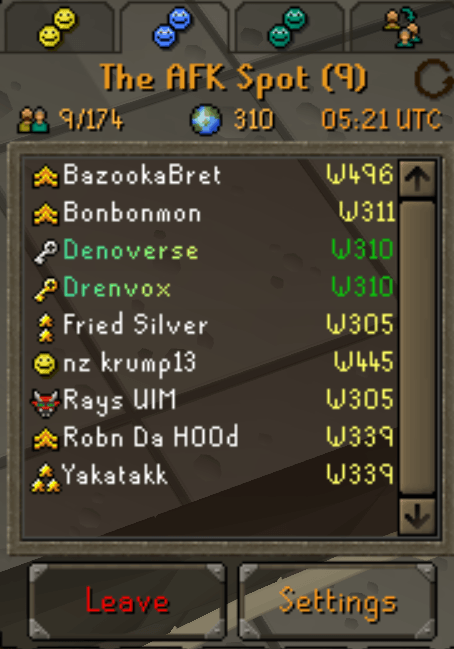

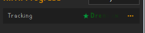

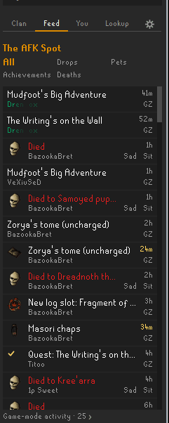

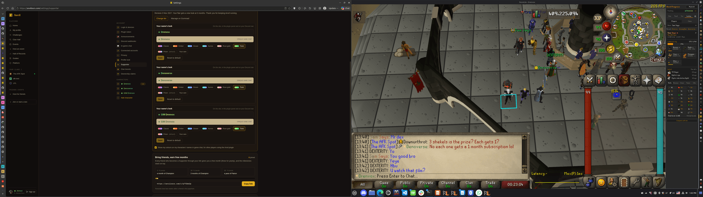

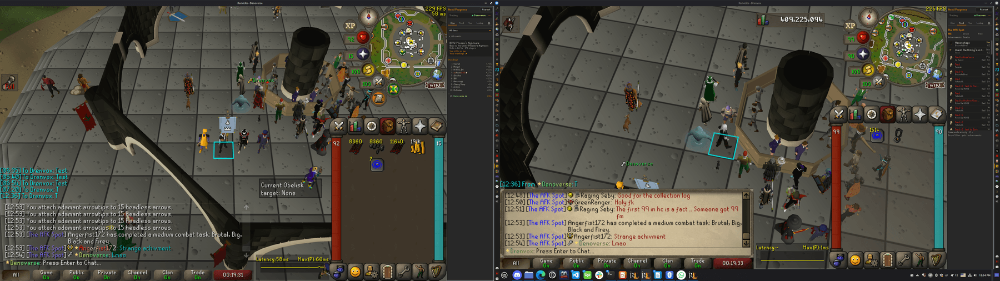

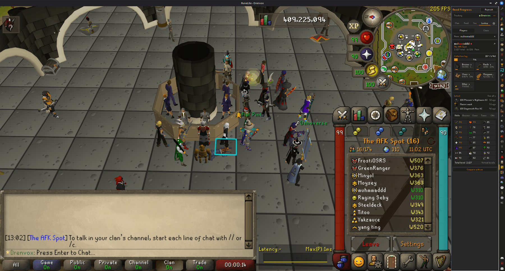

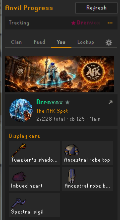

## 2. Animation timing and resilient repainting

- [x] Change **all** supporter/clan gradient animation surfaces to a 5-second cycle.
- [x] Replace the local chat-specific 3-second constant (`GradientLabel.GAME_CYCLE_MS = 3000`) with 5 seconds.
- [ ] **VERIFY** Keep animation phase consistent enough that two clients do not visibly jump when a panel refreshes.
  - LOCAL fix (7 Nov): `GradientLabel.animationTimeMillis()` is now the wall clock (epoch ms) instead of time since plugin start/toggle, so rebuilds never reset phase and clock-synced clients share it. Check with two clients.
- [x] Fix clan title animation being overwritten by the game when members join/leave or the clan interface redraws.
- [x] Reapply the decorated clan title when the game replaces the widget, without requiring a tab switch.
- [ ] Verify static fallback remains stable on parchment and other unsupported/light surfaces.

References:

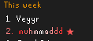

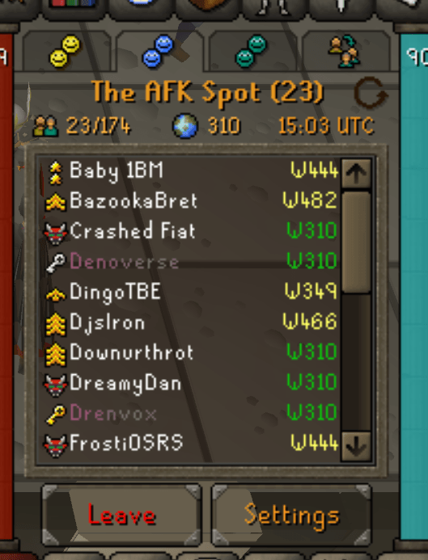

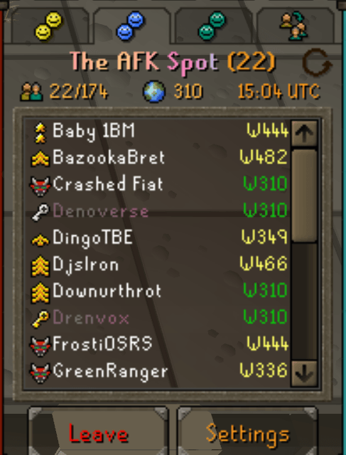

## 3. Chat rendering correctness

- [ ] **VERIFY** Fix occasional overlap between a decorated name and the chat message text.
  - LOCAL fix (7 Nov): `makeRoom` treated "x/width equals the value we last set for this slot" as already moved. A longer name's plain layout could land exactly on a shorter starred name's moved spot ("Sam Says" after "MaxAcc"), so the message wasn't moved. Now also keyed on the sender line (`ChatFlair.alreadyRoomed`, `chatboxRoomFor`); test in `ChatFlairTest`.
- [x] Make decoration idempotent: repainting an already decorated historical line must not add another star or another name-width shift.
- [x] Fix the transient two-star state after changing a colour.
- [x] Clear/rebuild chat decoration state when flair data changes, login state changes, or the active character changes.
- [x] Refresh historical visible lines when the flair dataset changes; old pre-logout messages and new messages must render identically.
- [x] Add a small off-screen scroll “runway” so lines just above/below the viewport are decorated before they become visible.
- [ ] Prevent names from snapping into a new colour only after scrolling them fully into view.
- [x] Retain chat performance by limiting the runway and using cached/idempotent measurements.
- [x] Add regression tests for duplicate stars, repeated decoration, same-version cache repair, and name/message spacing calculations.

References:

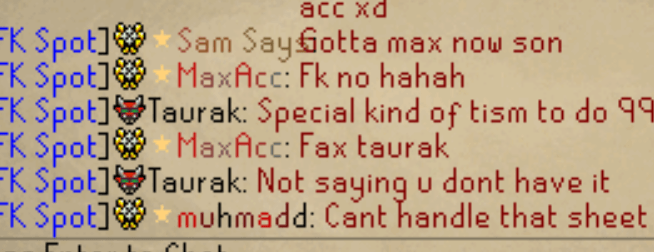

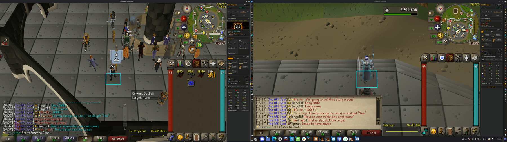

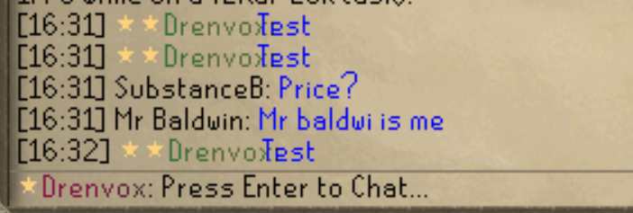

## 4. Clan and player media entitlement rules

- [x] Animated clan banner and clan icon/logo require Level 2 or higher; below it, serve a static frame.
- [x] Animated profile/avatar media require Champion or Patron; lower tiers receive a static frame.
- [x] Keep a static custom upload visible for lower tiers; only motion is downgraded.
- [ ] Apply identical entitlement rules on Site pages, Plugin Clan, Feed, You, Lookup, and any Discord/render output.
- [x] On entitlement downgrade, preserve uploaded assets and render them statically rather than deleting them.
- [x] On later re-upgrade, resume animation without requiring a re-upload.
- [x] Supporter tier loss/downgrade preserves colour settings and uploads while disabling only unavailable animated benefits.
- [x] A temporary Patron grant is a separate overlay row and does not cancel/deactivate the user’s paid Supporter subscription.

## 5. Media loading, updates, caching, and visual quality

- [x] Do not show an image and then instantly hide it.
- [x] Start panel media hidden/collapsed and reveal it only after successful decode.
- [x] Keep failed media collapsed without leaving a black rectangle or layout hole.
- [x] Update the existing `UiViewTest` placeholder expectation to the hidden-until-success behaviour.
- [x] Render circular profile images through an anti-aliased off-screen mask so the edge is smoothly rounded.
- [ ] **VERIFY** Fix animated clan banner/icon and user banner/avatar disappearing after the initial frame/load.
  - LOCAL fix (7 Nov): `BingoApiClient.animatedIcon` opened the GIF reader with `seekForwardOnly=true`, so `getNumImages(true)` threw `IllegalStateException` for **every** GIF and every motion image was refused (hidden-until-success then never showed it). Now opened searchable.
  - LOCAL fix: cached animated GIFs are `MotionIcon`s; each consumer gets its own AWT image (`copy()`), so a re-render/poll can't restart a shared image with a blank frame buffer.
  - LOCAL fix: `UiView.roundIcon` draws GIFs with `frameRepainter(c)` so round avatars/clan marks keep advancing (JLabel only follows frames for an `ImageIcon` it holds directly).
  - Covered by `MotionIconTest`; needs in-game confirmation.
- [ ] **VERIFY** the exact-size `w`/`h` route change fixes animated GIF rejection in the Plugin (the reader bug above was the main rejection cause).
- [x] Add media revision/cache-busting data so replacing an upload changes the Plugin UI JSON/URL.
- [x] Include entitlement/boost state in the clan media cache key so a static cached response cannot survive an upgrade to Level 2/3.
- [x] Clear in-memory thumbnail/UI caches on manual Refresh.
- [x] Make manual Refresh redraw the current tab even when its structural JSON is otherwise unchanged.
- [x] Make banner/icon/profile updates arrive automatically on the normal polling interval.
- [x] Ensure old Plugin clients continue to receive a usable static image when they omit the motion flag.
- [ ] Make the Plugin banner crop match the Site profile’s focal area as closely as the narrow panel allows.
- [ ] Fix banner, clan icon, and Feed header alignment.
- [x] Keep the clan icon visible after initial Feed/Lookup rendering instead of showing and immediately hiding it.
- [ ] Confirm animated banner playback works in Clan, Feed, You, and Lookup, not only the Site.

References:

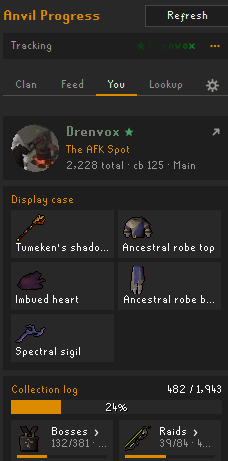

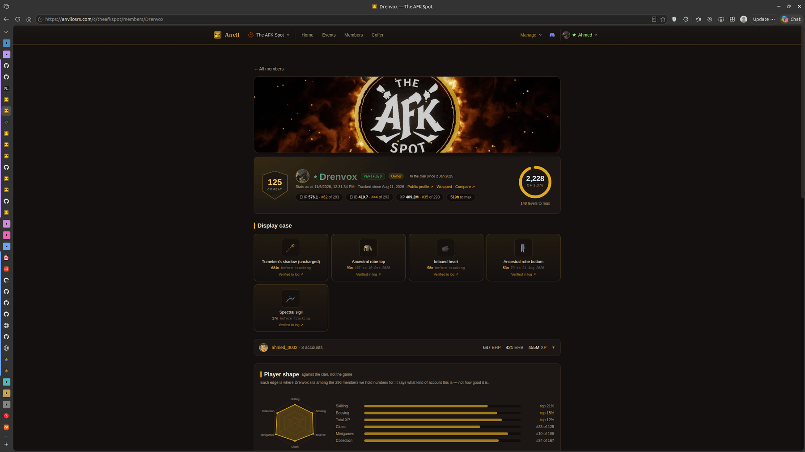

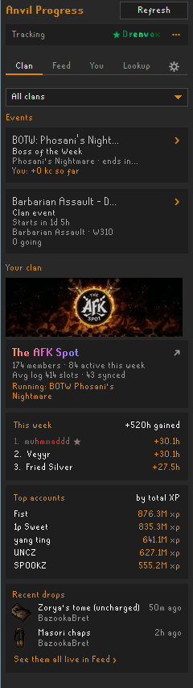

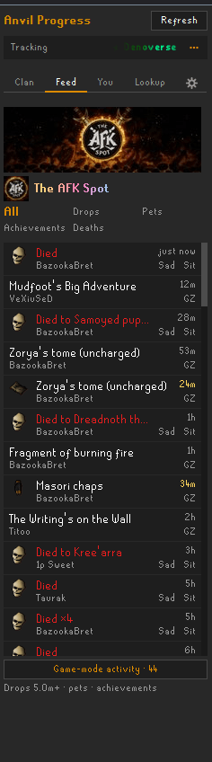

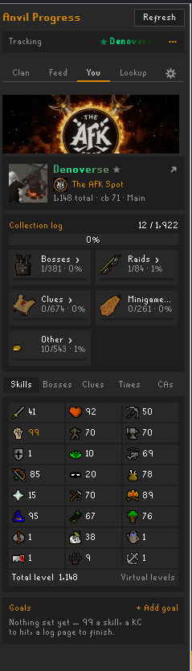

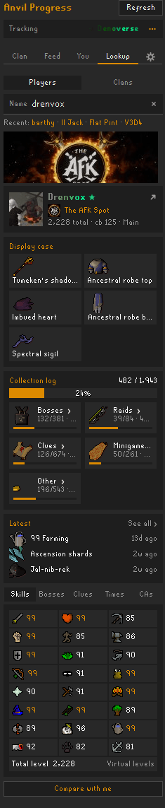

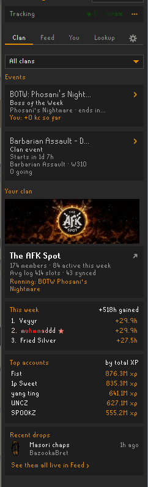

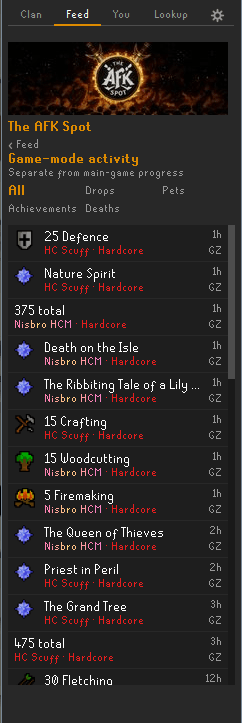

### Found in-game testing (7 Nov, against PRODUCTION Site `ae979c6a`)

Note: the dev client talks to `anvilosrs.com`, which lacks all uncommitted 1.18.3 Site work. Re-test against beta after the Site push (`./gradlew run -Danvil.site=https://beta.anvilosrs.com`).

- [ ] **VERIFY** Animated banner/icon played once then stopped. Cause: sharp `.gif()` inherits the source loop count (an animated upload stored with loop 1 → play once; Java honours it). Fixed: `loop: 0` in `pluginPanelMedia.ts` and the Discord crest GIF (`crestImage.tsx`). Site fix — needs deploy.
- [ ] **VERIFY** Clan icon squished / Lookup identity lines clipped. Cause: `row()` `capH`s at build time while the hidden-until-success image is 0x0, so a 28/36 px mark (and the column below an 18 px clan logo) is cropped to text height. Fixed: `UiView.growCappedAncestors` on reveal; test in `UiViewTest`.
- [ ] **VERIFY** Tracking header name white; Lookup name one solid colour (Nisbro) while chat shows the gradient. Cause: `ChatPalette.readableHex` returns bare `rrggbb` but `Ui.teamColor` only accepts `#rrggbb`, so every adapted stop became the fallback. Fixed with `ChatPalette.readableColor` at all three call sites; test in `ChatPaletteTest`.
- [ ] **VERIFY** In-game clan title muddy and different from the panel. Cause: clan title stops went through the parchment (darken) path though the clan tab is dark stone. Fixed: dark path. Also needs the Site deploy for custom clan name styles (0224) to match.

## 6. Upload limits and server-side processing

- [x] Keep a 2 MB raw avatar limit; server re-encoding makes this a reasonable ceiling rather than a stored-file size.
- [x] Keep separate limits: 2 MB avatar and 6 MB banner.
- [x] Process profile uploads server-side with Sharp.
- [x] Strip unnecessary metadata.
- [x] Resize/crop to the profile targets and generate exact panel-size renditions on read.
- [x] Optimize static images to WebP.
- [x] Optimize animated GIF/WebP while preserving animation when entitled.
- [x] Reject decompression bombs, unreasonable dimensions/frame counts, and unsupported formats.
- [x] Document accepted formats, dimensions, limits, and motion fallback in the upload UI.
- [x] Support both static and animated banner/image uploads.

## 7. Clan boost gift semantics

- [x] Replace “minimum gifted tier” display semantics with dynamic platform boost contribution.
- [x] Store/retain the target gifted tier and expiry/indefinite state.
- [x] Compute platform boosts as the number missing from the target threshold.
- [x] Example: 3 organic of 8 required means 5 platform boosts.
- [x] Example: if an organic boost disappears and the clan has 2, platform contribution becomes 6.
- [x] Example: if organic boosts rise to 4, platform contribution falls to 4.
- [x] Never let platform contribution crowd out real boosts; it must shrink as real boosts arrive.
- [x] If real boosts naturally exceed the gifted target, use the naturally earned higher state.
- [x] Make progress bars/counts use the effective total, while retaining the organic count internally.
- [x] Expose organic count, platform-gift count, effective count, target tier, and expiry in the boost summary API.
- [x] Show the platform contribution publicly in the Boosters section.
- [x] Show clan admins who boosted and which boosts came from the platform.
- [x] Keep real booster names/counts and first-booster/level-up badges accurate.
- [x] Make the gifted contribution expire cleanly and fall back to the organic/grace state.
- [x] Add tests for real boosts increasing, decreasing, exceeding target, expiry, indefinite gifts, and grace interactions. (Pure `effectiveBoostLevel`/`giftTargetLevel` in `clanBoostRules.ts`, used by `reconcileLevels`; 8 new tests.)

Reference:

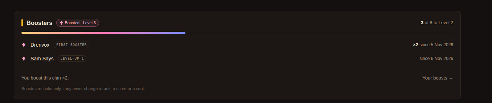

## 8. Temporary supporter benefit upgrades

- [x] Add a staff operation to grant a higher benefit tier for a fixed period (1–3650 days).
- [x] Keep the underlying paid subscription active and charged at its original tier.
- [x] Model the grant as an overlay/effective tier, not a replacement subscription.
- [x] On grant expiry/removal, restore the paid tier automatically.
- [x] Preserve stored colours, animations, and uploads through a downgrade; only gate their active use.
- [x] Show paid tier, temporary effective tier, grant source, and expiry clearly to staff. (`/staff/people` SupporterGift: Pays for / Invite time / Wears now, giver, note, ended-by; `supporterGiftRules.ts`.)
- [x] Add audit logging and tests for expiry, cancellation, paid upgrade/downgrade during a grant, and subscription loss. (Events already logged; now visible on /staff/audit with labels, `giftId` on grants; `tests/supporter-gift-rules.test.ts`. DB-backed `supporter-gifts.test.ts` not run: test Postgres down.)

## 9. Side-panel layout and navigation

- [ ] Improve the narrow clan banner crop and header spacing.
- [x] Add links under “This week” to the clan members page.
- [x] Add links under “Top accounts” to an all-time/appropriate filtered ranking.
- [ ] Verify those links route to the intended clan and filter.
- [x] Make the clan name/icon in a player profile clickable.
- [x] Clicking it must switch to Lookup → Clans, search the exact clan, and open that clan’s page.
- [x] Apply the click target in You and player Lookup views.
- [ ] Keep the narrow panel content aligned with the small clan icon.
- [ ] Improve the player Lookup top layout and broken-media fallback.
- [ ] Ensure Site player-profile presentation and Plugin player lookup share the same media and entitlement rules.

References:

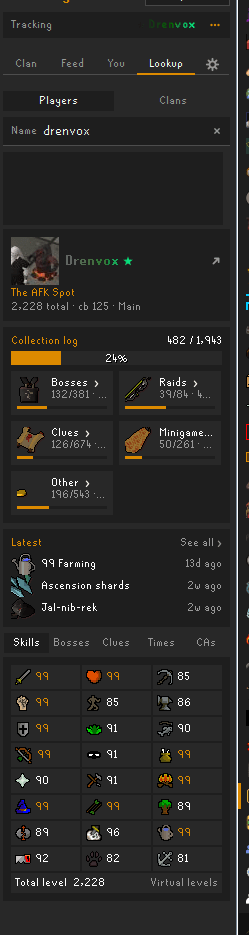

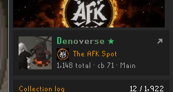

## 10. Activity Feed wording and iconography

- [x] Replace raw game-message achievement wording with concise activity copy.
- [x] Total-level example: “375 total”, not the full game chat sentence.
- [x] Strip the literal `Quest:` prefix.
- [x] Use a quest icon for quests.
- [x] Use the correct diary icon for achievement diaries.
- [x] Use combat-achievement icons/tier presentation for combat achievements.
- [x] Improve normal-feed combat-achievement wording such as Grandmaster/Master task lines.
- [x] Improve collection-log slot wording and use the actual item/log icon.
- [x] Use the relevant skill icon for skill levels.
- [x] Use the total-level icon for total milestones and maxed/total-level activities.
- [x] Fix the reported missing total icon in the Feed.
- [x] Use single item-scale icons for collection-log and drop rows.
- [x] Reserve four-times/large icons for boss/event presentation where intentionally designed.
- [ ] Confirm item-ID/icon-code resolution for Zorya’s tome and similar collection-log items.
- [x] Keep deaths visually distinct and concise.

References:

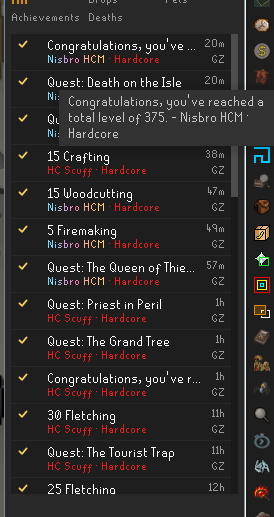

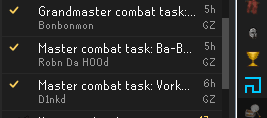

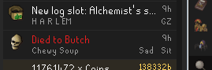

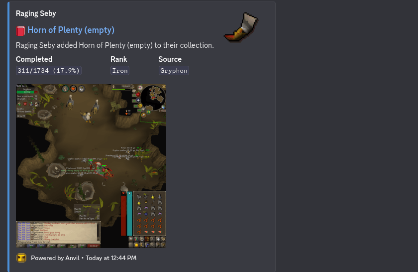

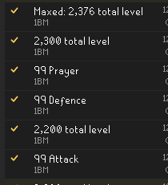

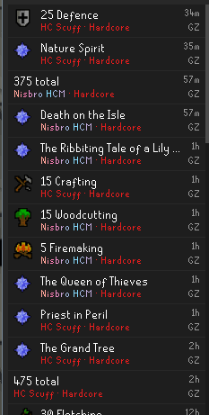

## 11. Player lookup/profile completeness

- [x] Initial player media and display-case data are present in the Site Plugin-UI response.
- [ ] Ensure player Lookup contains the player’s banner, avatar, display case, supporter style, clan, collection log, latest activity, and skills consistently.
- [ ] Ensure You and Lookup share components/behaviour where the content is identical.
- [x] Fix stale supporter colour after Refresh while remaining on You.
- [x] Public/signed-out lookup uses readable adaptive names.
- [ ] Verify avatar/banner use animated or static variants based on entitlement.
- [ ] Verify no content jumps when the media finishes loading.

## 12. Display-case “Verified in log” link

- [x] Fix the dead-end URL currently shaped like `/p/Drenvox?tab=collection&page=Chambers%20of%20Xeric`.
- [x] Use the canonical `/p/<rsn>?tab=collection&page=<page>` profile collection-log route.
- [x] Ensure the link selects the intended collection-log page/category, including same-path navigation.
- [x] Add a profile-link regression test.

## 13. BOTW zero-KC board membership

- [x] Fix the Plugin saying “not on the board yet” when the player appears in standings with `+0 kc`.
- [x] Treat an enrolled/standing row with zero gain as on the board.
- [x] Do not use positive gain as the membership test.
- [x] Normalize case, repeated whitespace, and non-breaking spaces when matching the current RSN to standings.
- [x] Add tests for enrolled zero, enrolled positive, genuinely absent, and case/whitespace-varied players.

References:

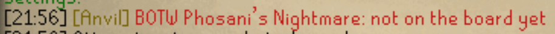

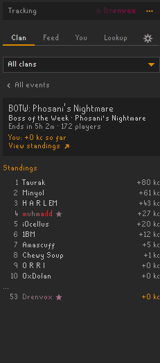

## 14. Game interfaces and dialogue names

- [x] Extend supporter/clan name colouring to player-name titles in quest dialogue and general dialogue interfaces where safe.
- [x] Use RuneLite gameval interface/widget constants rather than magic IDs.
- [x] Whitelist only name/title widgets; do not recolour arbitrary dialogue body text.
- [ ] Keep NPC names and game-authored semantic colours intact unless they exactly represent a styled player.
- [x] Restore original widget text/colour when flair refreshes/expires or the Plugin disables; weak widget keys disappear when an interface closes.
- [ ] Add tests for supported dialogue roots and safe no-op behaviour.

## 15. Compact chat-flair endpoint scalability

- [x] The endpoint already uses a compact style table plus a names array and style-index array (`styles`, `names`, `ix`) instead of repeating full style objects per character.
- [x] Measure the larger 200,000-name case: 2.87 MB JSON and 1.22 MB gzip (about 109 ms to gzip locally); 50,000 names are comfortably below it.
- [x] HTTP gzip, ETag/conditional requests, and immutable version cache headers are enabled.
- [x] Avoid downloading unchanged payloads through version checks, deltas, ETags, and the Plugin disk cache.
- [x] Use the existing revision/delta endpoint; a compact full snapshot remains the fallback when too many revisions were missed.
- [x] Document the compact field names for maintainers:
  - `v`: schema/revision version.
  - `styles`: deduplicated colour/gradient style table.
  - `c`: static/base colour.
  - `g`: gradient stops.
  - `s`: supporter/star eligibility flag.
  - `names`: normalized character names.
  - `ix`: style-table index corresponding to each name.
- [x] Add payload-shape, index-alignment, delta, and 200,000-name load tests.

Reference:

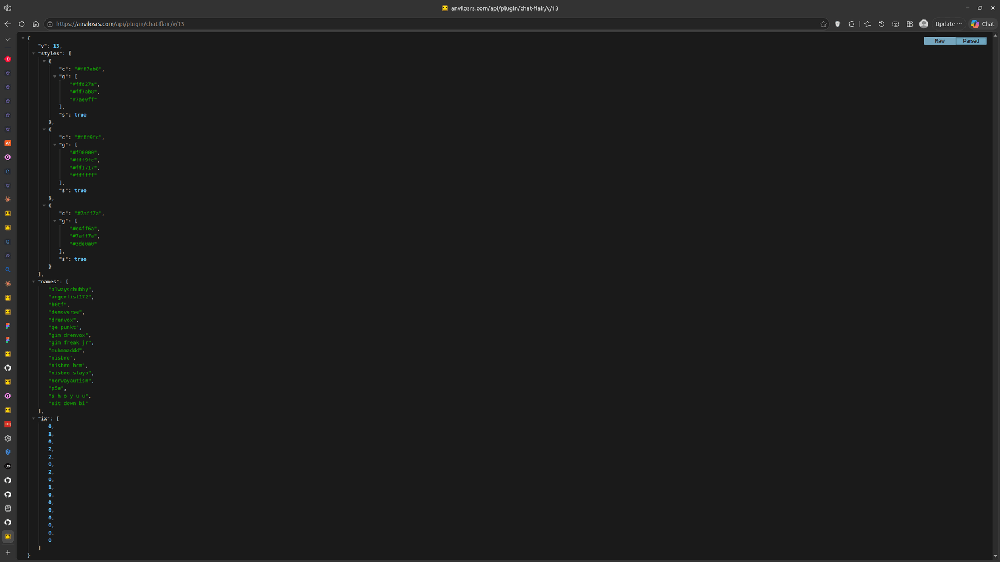

---

> **7 Nov decision (owner):** skip 1.18.3 — this work ships as **1.19** together with per-surface name colours. Re-tag/release notes need the owner's approval.

## 16. Per-surface name colours (1.19)

- [x] Optional dark-surface and light-surface looks (full style each) for supporter styles (account + per-character) and clan boost name styles; when set, drawn as-is on that surface, else the main look is auto-adapted. No migration (JSON columns).
- [x] Site: validation, shared surface helper (`inkForSurface`), editors with dark/parchment previews (`NameSurfaceLooks.tsx`), chat-flair `d`/`l` per style, plugin config `boostNameDarkStops`/`boostNameLightStops`, panel UI JSON uses the dark look. Champion's two-colour limit counts main looks only (decide).
- [x] Plugin (LOCAL): `ChatFlair.Surface d/l` on entries (intern key includes them); dark chatbox/menus/interfaces use `d`, parchment uses `l`, a solid override drops the gradient; Tracking header uses `d`; clan title uses `boostNameDarkStops`. Tests in `ChatFlairTest`.

## 17. Placeholder "#PlayerNNN" join requests (prod)

- [x] Cause: hello sent on the first tick after LOGGED_IN while the client still names the player "#Player<n>"; the site stored it as an account + pending join request. 21 placeholder accounts / 15 plugin join requests in prod (9 pending: theafkspot 2, lfl 3, new-hope 4).
- [x] Plugin (LOCAL): `identityReady`/`sendHello` wait for a real name (`placeholderName`), hello not marked sent for a placeholder. Test in `IdentityStampTest`.
- [x] Site (LOCAL): hello route writes nothing for an implausible RSN; `pendingRequests` hides placeholder rows.
- [x] Prod cleanup of the placeholder accounts/requests (approved and done 7 Nov; 826/827 kept).
- [x] Prod cleanup done 7 Nov: 19 placeholder players deleted (cascade: 19 accounts, 15 join requests, 4 junk seats, 15 analytics rows); 826/827 kept (hashed, player 46). Backup CSVs in the session scratchpad `prod-placeholder-backup/`.
- [x] New admission rule (owner, 7 Nov): a plugin user with no seat becomes an Anvil character with no clan (own in-game clan → ghost clan). A join request (staff approval) is filed only when their fresh in-game clan report matches the clan's *verified* in-game name: hello checks `reportedAnvilClanId`; `/game-clan` files it when the report arrives later. Roster sync still seats synced members directly.
- [ ] Gap to decide: `/game-clan` only accepts characters the token owns; a brand-new unclaimed character's clan report is refused until claimed, so its request waits for the claim.
- [x] Clan feed push lines now paint the sender from the flair dataset per surface (own d/l look, else adapted), falling back to the push's raw colours.
- [x] In-game clan title kept the stale member count over the live one (animate loop repainted cached suffix). Now re-reads the suffix when the game rewrites the title (`ChatFlair.clanTitleSuffix`, test).

---

## 18. Migration ordering with feat/reach-out (IMPORTANT)

- [ ] `0226_account_media` (per-character banner/avatar overrides) has journal `when` 1794059660668; reach-out's `0225_reach_out` has 1794049679413. `scripts/migrate.mjs` uses drizzle `migrate()`, which skips any migration whose `when` is older than the last applied one. **Whichever branch merges second must bump its journal `when` above the other's** (both SQL files use IF NOT EXISTS, so re-running is safe). Expected: 0226 ships first, so reach-out bumps 0225's `when` above the newest of ours on rebase (now 0228 at 1794059860668; 0226 and 0227 sit below it).

---

# Verification checklist

## Site

- [x] Run focused unit tests for supporter style, media animation, profile media, Plugin UI views, clan-boost rules, feed achievements, embeds, and compact flair payloads.
- [ ] Run database-backed Plugin UI tests with the required local DB/network permission.
- [ ] Run lint.
- [ ] Run a clean production build.
- [ ] Inspect the relevant pages at desktop and narrow widths.
- [ ] Verify signed-in and signed-out rendering.
- [ ] Verify low-tier, Champion, Patron, and expired/downgraded states.
- [ ] Verify clan organic Level 0/1/2/3 and gifted Level 1/2/3 states.

Current verification notes (2026-11-07):

- `npx tsc --noEmit` passes.
- Changed-file ESLint passes with no errors; only two pre-existing `Date.now()` purity warnings remain in `ProfileTabs.tsx`.
- Full-repository ESLint is not a usable green gate yet: it scans checked-in `.claude/worktrees` copies and the main tree already has two unrelated `momentsStore.ts` clan-scope errors.
- Turbopack production build is blocked in this environment because its CSS worker cannot bind a local port (`EPERM`). The webpack fallback reaches a separate existing Next/TypeScript `--showConfig` parsing failure.
- DB-backed tests cannot start because the expected local PostgreSQL test service at `127.0.0.1:5439` is not running (`ECONNREFUSED`).

## Plugin

- [ ] Add/update unit tests for every regression above. (Done for every 7 Nov fix; dialogue roots §14 still missing.)
- [x] Run `./gradlew test` after the final code changes.
- [ ] Offer `./gradlew run` for user-controlled in-game verification; the user must log in manually.
- [ ] Test two clients at once with different signed-in accounts.
- [ ] Test another player’s flair, the current user’s flair, historical messages, relogging, and scrolling.
- [ ] Test clan member join/leave while the clan interface is open.
- [ ] Test static and animated player/clan media before and after Refresh.
- [ ] Test a media update made on the Site while the Plugin remains open.

## Release

- [ ] Review `git diff` in both repositories for accidental/unrelated changes.
- [ ] Confirm the actual Site production state because `origin/main` and `origin/beta` currently point at the same commit.
- [x] `v1.18.3` tag stays at `1618fec2` (already on beta); this ships as 1.19.0 (owner, 7 Nov).
- [ ] Commit Site changes without a co-author trailer.
- [ ] Push Site `beta` and verify its deployment workflow.
- [ ] Commit Plugin changes without a co-author trailer.
- [ ] Push the intended Plugin release branch.
- [ ] Promote Site **1.19.0** only if production is not already at the desired commit.
- [ ] Confirm the release remains silent.
- [ ] Smoke-test production API media, chat-flair payload, Site profile, clan boosts, and Plugin UI.

## Definition of done

- [ ] Every release-blocking item above is checked or explicitly deferred by the user in this file.
- [ ] No image/name flashes from visible to hidden.
- [ ] No duplicate stars, overlap, stale colours, or clan-title resets remain.
- [ ] Dark colours are readable everywhere without changing the user’s saved design.
- [ ] Gifted boosts dynamically fill only the gap to the target tier.
- [ ] Animated media obeys entitlement rules and static fallback remains available.
- [ ] Site and Plugin tests/builds pass.
- [ ] Beta is verified before any production action.

